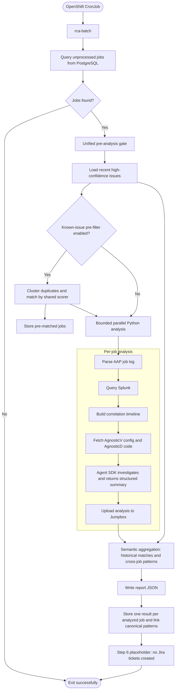

# aap2-rca-agent

Automated root-cause analysis for failed Ansible Automation Platform (AAP)
jobs on the Red Hat Demo Platform (RHDP). The Python package runs the batch
workflow and deterministic analysis; packaged prompt templates provide
per-job RCA, synthesis, and semantic aggregation guidance.

## Architecture



## Installable Python package

The source tree uses the `src/rca` package layout. Runtime dependencies and
console entry points are declared in `pyproject.toml`; reusable modules are
installed once rather than copied into separate `common/` and batch-script
trees. `rca-batch` is the Python Agent SDK batch coordinator. The existing
packaged system prompt supplies per-job RCA guidance without an on-disk Skill.

```bash
python3 -m venv .venv
.venv/bin/pip install -e '.[dev]'
.venv/bin/pytest
```

`rca-analyze` preserves the manual single-job and debugging commands:

```bash
rca-analyze analyze --job-id 1234567 --fetch
rca-analyze analyze --job-log /path/to/job.json.gz
rca-analyze parse --job-log /path/to/job.json.gz
rca-analyze query 'index=ocp_apps "x1234"' --earliest=-24h
rca-analyze status 1234567
rca-analyze upload --job-id 1234567
```

The CronJob runs `rca-batch` directly. The legacy
`deploy/batch-rca-automation/batch_rca_headless.sh` path remains as a thin
compatibility wrapper that forwards arguments to `rca-batch`.

For a local batch run (after installing the package and configuring the
required settings):

```bash
rca-batch --limit 15
```

Use `--no-pre-filter` to skip matching jobs against recent known issues.
`RCA_MAX_PARALLEL_JOBS` sets the bound for parallel job pipelines and Agent SDK
queries (default `5`). The Step 6 Jira ticket preparation hook is intentionally
a no-op for now; no Jira integration or ticket creation is performed.

Per-job synthesis uses one Claude Agent SDK query to investigate artifacts,
verify GitHub evidence, and return the final summary. Python generates the
response schema from `AnalysisSummary.model_json_schema()`, constrains `job_id`
to the requested job, and passes it through the SDK's `output_format` option.
The SDK owns structured-output validation and
retries through its `StructuredOutput` tool. Python atomically writes the
successful `structured_output` to `step5_analysis_summary.json` and performs and
verifies upload. An SDK error or missing structured result fails the job.
See the [Agent SDK structured-output documentation](https://code.claude.com/docs/en/agent-sdk/structured-outputs)
for its validation and error behavior.
For GitHub configuration or code evidence with no event time in the supplied
artifacts, an empty `timestamp` string represents unavailable time.

All Claude model work uses the Agent SDK with the existing `CLAUDE_MODEL` and
backend configuration:
`CLAUDE_CODE_USE_VERTEX=1`, `CLOUD_ML_REGION`, `ANTHROPIC_VERTEX_PROJECT_ID`,
and optional `GOOGLE_APPLICATION_CREDENTIALS` for Vertex; otherwise
`ANTHROPIC_API_KEY` or `ANTHROPIC_AUTH_TOKEN` and optional `ANTHROPIC_BASE_URL`.
`CLAUDE_MODEL` is passed unchanged to the SDK; when it is unset, the SDK uses its
default model. The Helm deployment sets an explicit model. Token usage and cost
estimates come from the SDK's terminal result and model usage.

## Configuration and state

Configuration is read as data from `RCA_SETTINGS_FILE` (default discovery:
`./.claude/settings.json`, `./.claude/settings.local.json`, then
`~/.claude/settings.json`), `.env`, and the process environment. Precedence is
`.env` < `settings.json` < process environment. JSON values are parsed as
scalars and are not treated as shell code by Python.

Important settings include:

- `SOURCE_DB_*` for the AAP source and results tables.
- `JOB_LOGS_DIR`, `REMOTE_HOST`, and `REMOTE_DIR` for job-log retrieval.
- `SPLUNK_*` and `GITHUB_TOKEN` for deterministic enrichment.
- `JUMPBOX_URI` for uploading completed analysis when using a direct SSH target.
- Optional `SSH_JUMPBOX_ALIAS` to route uploads through a host configured in
  `~/.ssh/config` (the Helm cluster deployment uses `ci-jumpbox`). When set,
  SSH and rsync use the alias and take its host, user, and port from SSH config.
- `RCA_STATE_DIR` (default `~/.rca`) for writable reports and analysis state.
- `RCA_MAX_PARALLEL_JOBS` for bounded batch concurrency (default `5`).

Batch reports are written to `$RCA_STATE_DIR/reports/`. Per-job artifacts are
stored under `$RCA_STATE_DIR/.analysis/{job_id}/`.

`rca.models` provides Pydantic models for all seven JSON artifact contracts.
These define generated summaries, raw semantic aggregation responses, final
batch reports, and assembled root-cause details. Per-job synthesis and semantic
aggregation derive response schemas from `AnalysisSummary` and
`BatchSemanticOutput` with `model_json_schema()` and pass them to the Agent SDK. There are
no separately maintained JSON schema files. Models preserve rules for required
fields, nullable values, extra properties, and strict JSON types. Step 5 uses the
SDK's validated structured result directly; other model validation keeps the
original output dictionaries. Callers serializing
models should use `model_dump(exclude_unset=True)` to preserve omitted fields.
Stored root-cause validation retains its existing warning behavior, and invalid
semantic output uses the existing deterministic matching fallback.

## Performance

| Metric | Value |
|---|---:|
| Jobs analyzed | 50+ jobs/day |
| Success rate | ~95% |
| Init time | ~14 seconds |
| Analysis time | 2–3 minutes for 5–7 jobs (parallel) |

These figures describe the production workflow before packaging; the
package-layout change is intended to preserve its behavior.

## Output

Batch reports are written to
`$RCA_STATE_DIR/reports/batch_YYYYMMDD_HHMMSS.json`:

```json
{
  "batch_id": "batch_YYYYMMDD_HHMMSS",
  "generated_at": "2026-09-30T12:00:00Z",
  "total_jobs_requested": 4,
  "total_jobs_analyzed": 3,
  "total_jobs_failed": 1,
  "timing": {
    "agent_spawn": "2026-09-30T12:00:00Z",
    "agent_completion": {},
    "wall_clock_total_ms": 150000,
    "aggregation_completed_at": "2026-09-30T12:02:30Z"
  },
  "root_cause_category_breakdown": {
    "infrastructure": {
      "count": 3,
      "job_ids": ["1234567", "1234568", "1234569"],
      "description": "Infrastructure"
    }
  },
  "confidence_breakdown": {"high": 2, "medium": 1, "low": 0},
  "high_priority_recommendations": [],
  "job_summaries": [
    {
      "job_id": "1234567",
      "result_id": 42,
      "status": "analyzed",
      "historical_matches": [
        {
          "matched_result_id": 9,
          "recurrence_count": 3,
          "similarity_reasoning": "Same worker timeout signature.",
          "pattern_id": "9",
          "confidence": "high",
          "evidence": [
            {
              "statement_type": "observed",
              "kind": "error_signature",
              "description": "Both jobs report worker 7 timing out.",
              "source": "splunk"
            }
          ]
        }
      ]
    }
  ],
  "failed_analyses": [],
  "cross_job_patterns": [
    {
      "pattern": "Worker 7 timeout",
      "jobs": ["1234567", "1234568"],
      "description": "Both jobs time out in worker 7.",
      "source": "current_batch",
      "pattern_id": "9",
      "confidence": "high",
      "evidence": [
        {
          "statement_type": "observed",
          "kind": "component",
          "description": "Worker 7 is the failing component in both jobs.",
          "source": "splunk"
        }
      ]
    }
  ]
}
```

`pattern_id` is a report signal representing the canonical result ID for a
linked issue cluster. The durable relationship is stored in
`related_result_id`, with `related_result_confidence` annotating the link. The
anchor row has a null `related_result_id`; every other cluster member points
directly to that anchor.
`historical_matches` and `cross_job_patterns` remain report signals, but the
durable grouping is the canonical `related_result_id` anchor. Every analyzed
job gets its own result row. A cluster can therefore be read with a single
equality query on `related_result_id` and does not require recursion.

Per-job analysis files are saved under `$RCA_STATE_DIR/.analysis/{job_id}/`:
job context, Splunk logs, the correlation timeline, GitHub fetch history, and
the Step 5 analysis summary.

## Deployment and tests

The Docker image uses `python:3.12-slim` and installs the package, including
the pinned Claude Agent SDK. The CronJob prepares SSH/GCP credentials in its
init container before running `rca-batch`.

Use `deploy/run-eval.sh <job-id>` to run the installed single-job entry point
inside the existing eval pod.

```bash
.venv/bin/pytest
tests/run_integration_tests.sh
helm lint deploy/helm -f deploy/helm/values.example.yaml
```

PostgreSQL integration tests use a separate local test database and skip when
it is unavailable. Never point the test database settings at production.

### GitOps (ArgoCD)

`deploy/argocd/application.yaml` defines an ArgoCD Application that deploys
the chart from this repository's `main` branch using
`deploy/helm/values-gitops.yaml`, adopting the resources of the legacy
`rhdp-rca` helm release in `rh-ace-aiops`. The application uses manual sync:
ArgoCD reports drift, and changes are applied only when a sync is triggered
deliberately. The CronJob is kept suspended via `cronjob.suspend` and is
enabled by setting that value to `false`. Secret contents are managed
out-of-band in the namespace and are excluded from syncing via
`ignoreDifferences`; once the application is in place, helm must no longer be
used to upgrade the `rhdp-rca` release.

## License

Apache License 2.0 — see [LICENSE](LICENSE).
