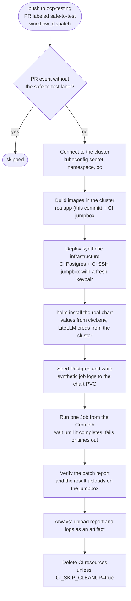
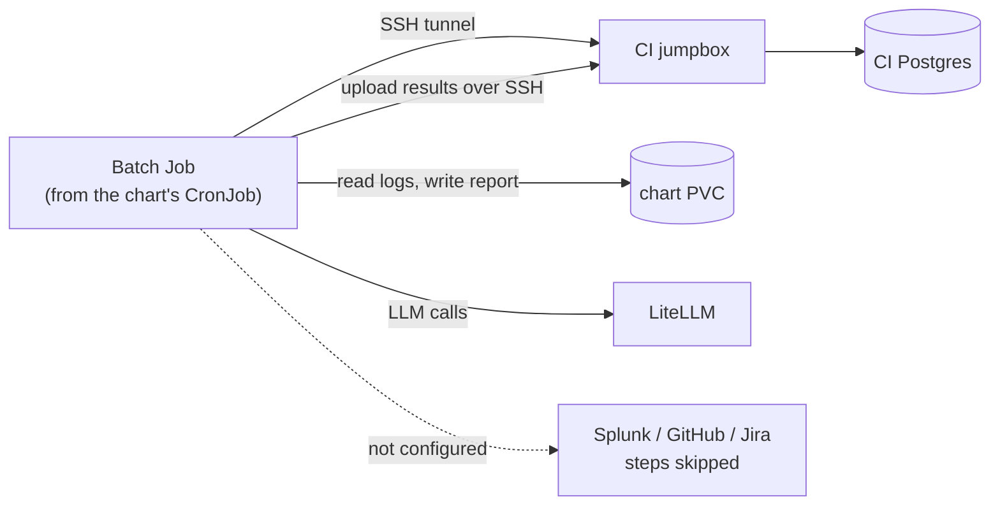

# CI testing flow

Two workflows run in CI:

- **`tests.yml`**: unit and integration tests. Runs on every push and every PR.
- **`batch-cronjob.yml`**: installs the real Helm chart on OpenShift and runs one batch from the actual CronJob. Everything it talks to is synthetic: a CI Postgres, a CI SSH jumpbox and generated job logs.

All CI names, ports, DB settings and the model live in `ci/ci.env`. The workflow loads it into the job environment and renders the manifests, Helm flags and settings JSON from it; `ci/setup-namespace.sh` sources it too.

## Overview

## `tests.yml`

## `batch-cronjob.yml`

- **Trust gate:** `pull_request_target` runs the PR's code with cluster credentials, so
  PR runs only start when a maintainer adds the `safe-to-test` label.
- **One run at a time:** runs share a concurrency group and queue rather than cancel.
- **Fail fast:** if any step fails, the run skips straight to artifact upload and cleanup.
- **What is checked:** `ci/verify_report.py` checks the report's structure and counts, not the LLM text.
  Every job marked `analyzed` must also have an upload directory on the jumpbox.

### What the batch Job does in the cluster

The chart's SSH settings point at the CI jumpbox and its database settings at the CI Postgres,
so the CronJob uses its normal tunnel and upload paths against synthetic infrastructure only.

