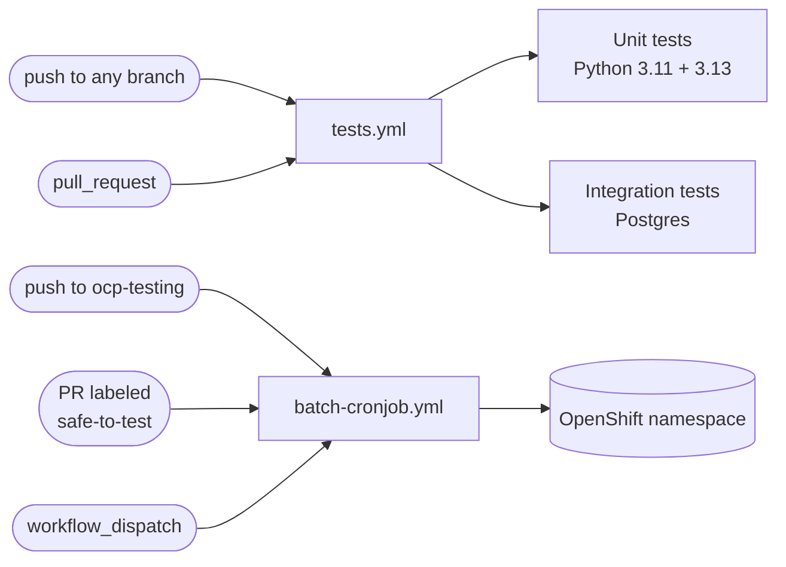
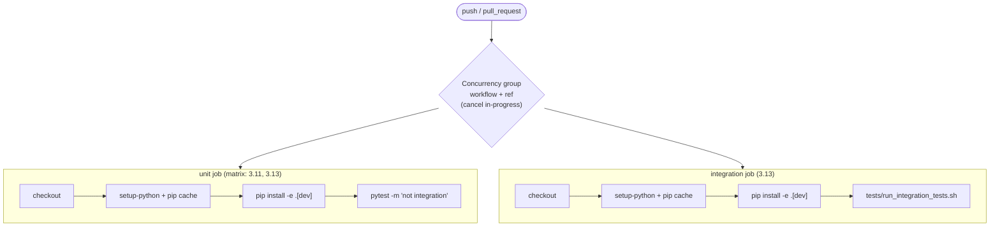
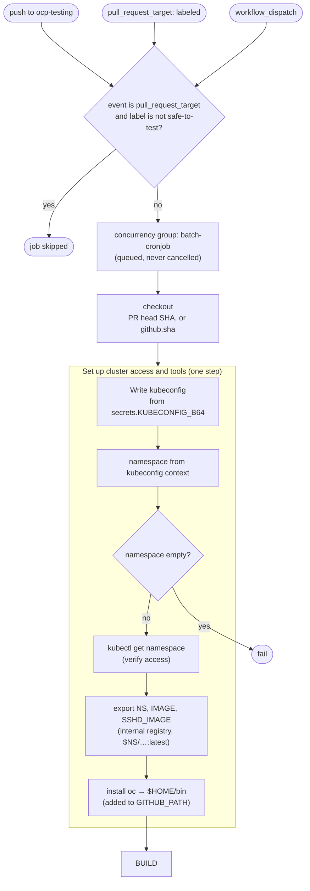
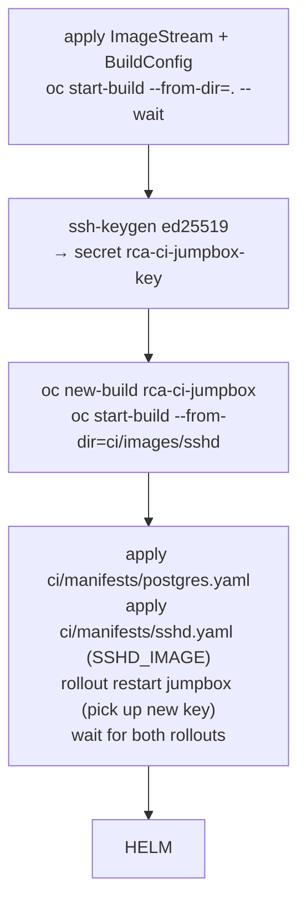
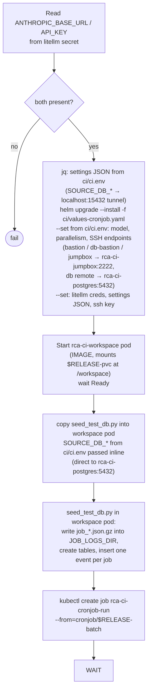
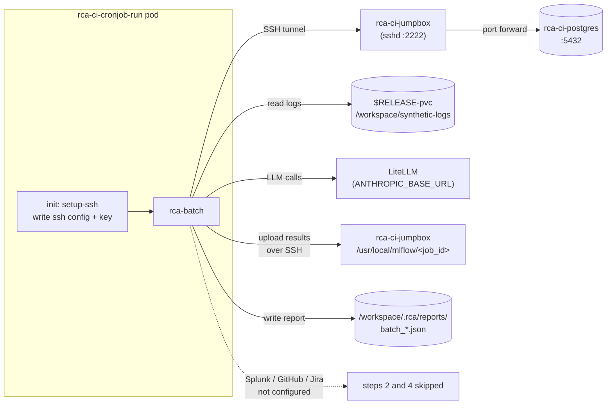
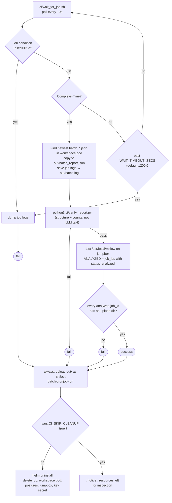

# CI testing flow

Two workflows run in CI:

- **`tests.yml`**: unit and integration tests. Runs on every push and every PR.
- **`batch-cronjob.yml`**: installs the real Helm chart on OpenShift and runs one batch from the actual CronJob. Everything it talks to is synthetic: a CI Postgres, a CI SSH jumpbox and generated job logs.

All CI names, ports, DB settings and the model live in `ci/ci.env`. The workflow loads it into the job environment and renders the manifests, Helm flags and settings JSON from it; `ci/setup-namespace.sh` sources it too.

## Overview

## `tests.yml`

## `batch-cronjob.yml`

### Trigger, gate and setup

### Building images and synthetic infrastructure

### Chart install, seeding and the batch run

### What the batch Job does in the cluster

### Waiting, verification and cleanup

